# Vehicle Accessory Shop

An online shop and store-management dashboard for car filters (oil, air, fuel and cabin) in Bangladesh.
Customers find the filter that fits their car, pay by bKash, Nagad, card or cash on delivery, and follow the
order to their door. The store team runs orders, stock, customers and coupons from the admin.

**Stack:** Laravel 13 · PHP 8.4+ · Livewire 4 (with Alpine) · Tailwind CSS 4 · Vite · Chart.js · Pest · Postgres · FrankenPHP on Vercel

**Live demo:** [demo1.fusan.me](https://demo1.fusan.me) — sign in as `admin@example.com` or `customer@example.com`, password `password`.

## Screenshots

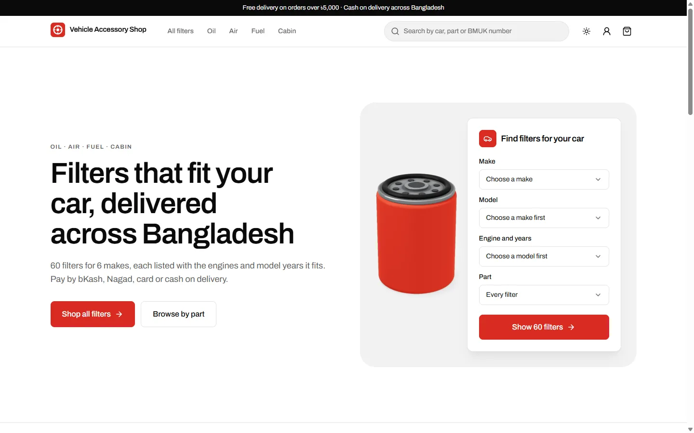

| Shop filtered to a car | Product page |
|---|---|
| 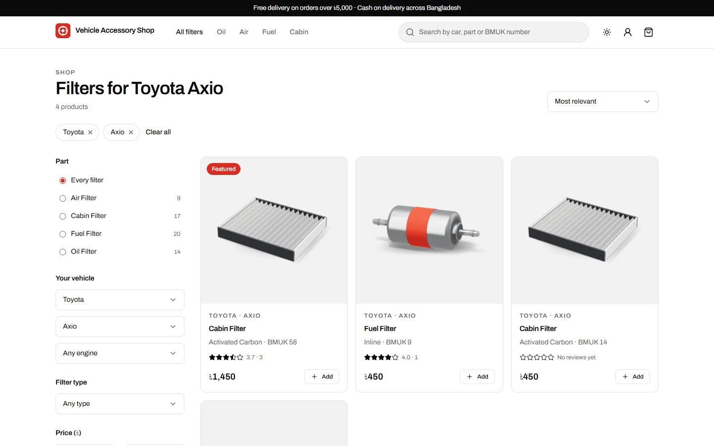 | 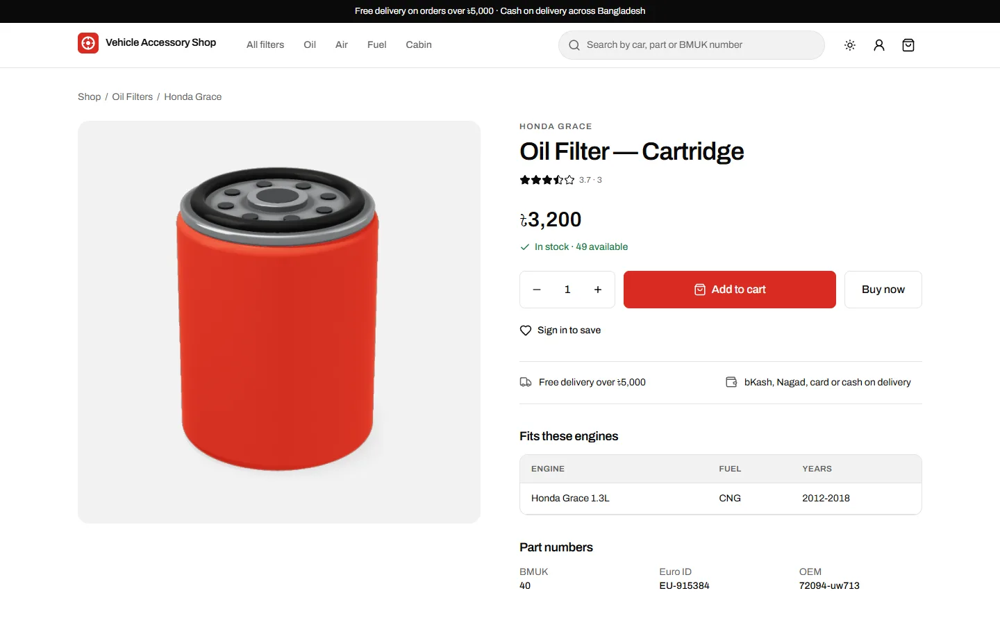 |

| Cart with a discount code | Checkout |
|---|---|
| 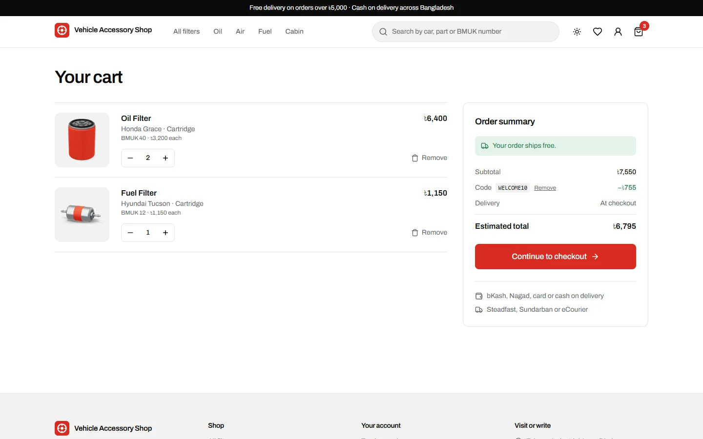 | 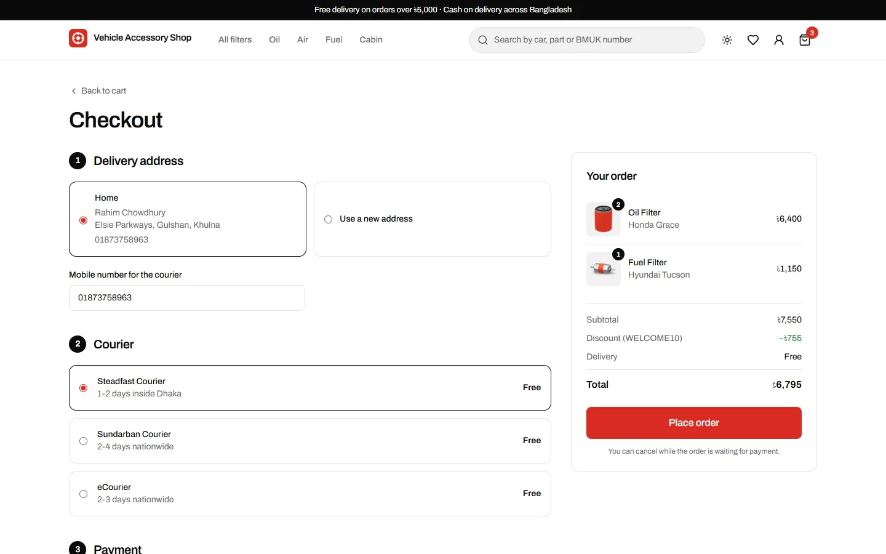 |

| Order timeline | Shop on a phone |
|---|---|
| 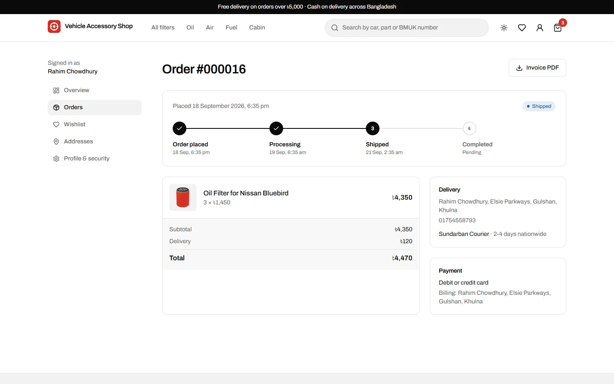 | 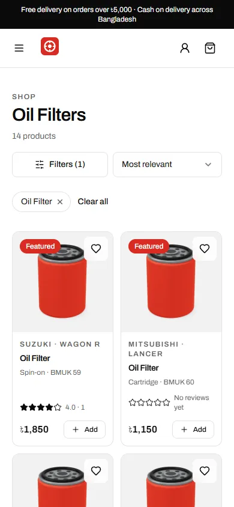 |

### Admin

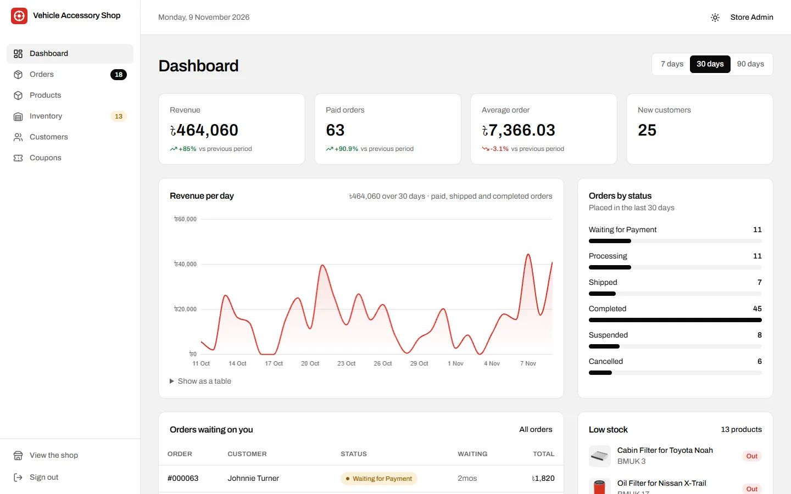

| Order with status controls | Inventory and stock ledger |
|---|---|
| 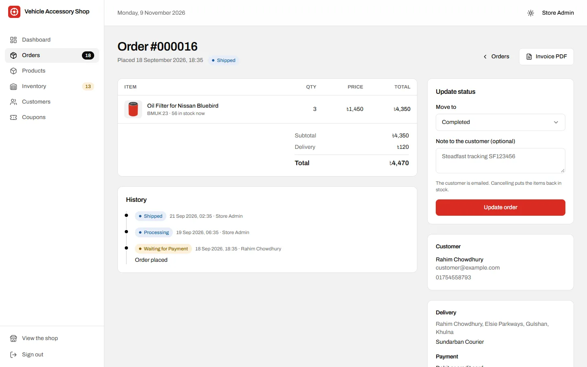 | 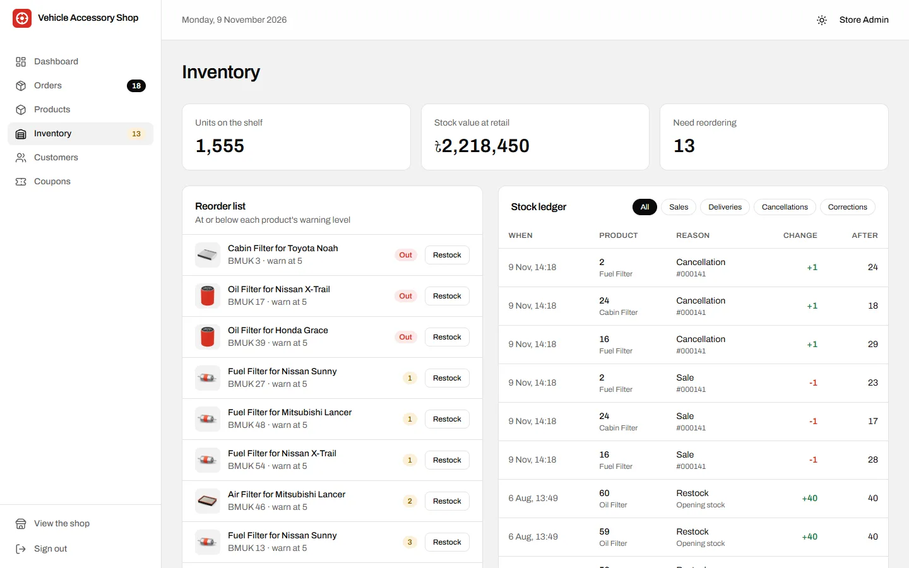 |

| Product editor | Dark mode |
|---|---|
| 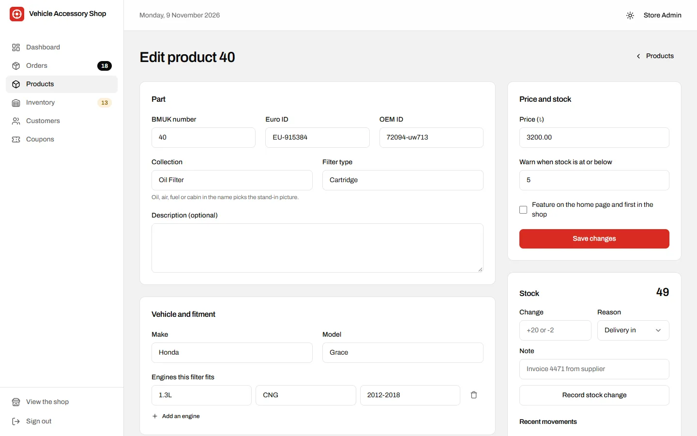 | 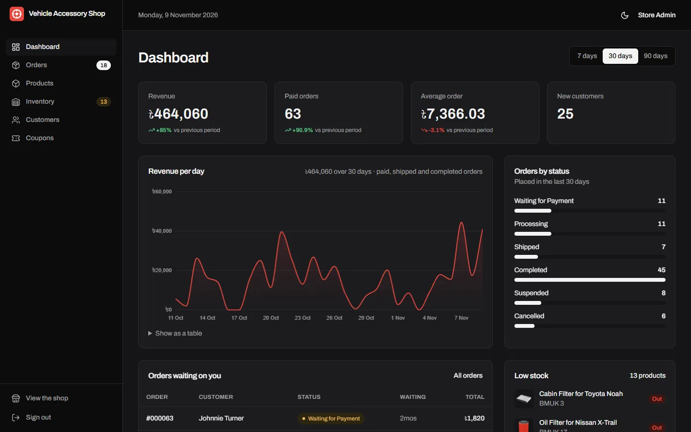 |

## Features

**Shop**
- Vehicle finder: make → model → engine and years, with a live count of matching filters
- Shop with URL-bound filters (part, make, model, engine, filter type, price, in stock), sorting and chips
- Live search suggestions in the header (brand, model, BMUK, Euro and OEM numbers)
- Product pages with gallery, fitment table, part numbers, rating breakdown, related and recently viewed products
- Guest cart that merges into the account on sign in; quantities capped at the stock on hand
- Discount codes (percentage or fixed, minimum spend, usage limit, start and end dates)
- Courier choice with per-courier rates and free delivery over a threshold
- Light, dark and match-device themes

**Customer account**
- Order list with status filter, order timeline, cancel while unpaid, PDF invoice
- Email on order placed and on every status change
- Address book with default delivery and billing addresses
- Reviews only from delivered orders, once per item
- Wishlist, profile, password change, account deletion

**Admin**
- Dashboard: revenue per day (7/30/90 days), paid orders, average order, new customers with change vs the previous period,
  orders by status, top products, low-stock list, orders waiting on you
- Orders: search, status and date filters, guarded status changes with notes, full history, CSV export
- Products: create/edit with fitment rows and gallery, soft delete, sortable list, CSV export
- Inventory: stock ledger for every sale, delivery, cancellation and correction; reorder list; stock value
- Customers: spend and order counts, manual verification, CSV export
- Coupons: create, schedule, cap and retire codes

**Security and quality**
- Every state change is a POST/PATCH/PUT/DELETE behind CSRF protection (the old GET links are gone)
- Policies stop customers opening other customers' orders, invoices and addresses
- Form requests validate every input (Bangladeshi mobile numbers, fitment years, coupon values)
- Rate limits on sign in, checkout, coupons, reviews and the contact form; honeypot on the contact form
- Stock is taken under row locks inside a transaction, and order lines keep the price they sold at
- CSV exports neutralise spreadsheet formulas
- 104 Pest tests

## Set up

Requires PHP 8.4+ (with `fileinfo`, `pdo_sqlite` or `pdo_mysql`, `mbstring`, `openssl`), Composer and Node 22+.

```bash
git clone https://github.com/FuSan21/Store-Management-Website.git
cd Store-Management-Website
composer install
npm install
cp .env.example .env
php artisan key:generate
touch database/database.sqlite        # or set DB_* for MySQL in .env
php artisan migrate --seed
composer run dev                       # or: php artisan serve + npm run dev
```

Demo accounts (password `password`):

| Role | Email |
|---|---|
| Admin | admin@example.com |
| Customer | customer@example.com |

Discount codes in the demo data: `WELCOME10` (10% over ৳1,000) and `SERVICE500` (৳500 off over ৳4,000).

Run the tests with `php artisan test` (or `vendor/bin/pest`).

## Upgrading an existing Laravel 8 database

The new migrations are additive. Run `php artisan migrate` against the existing database and it will:

- rename `password_resets` to `password_reset_tokens` and add the `sessions` table
- add stock, gallery, description and featured flags to products (existing products start with 25 in stock)
- add subtotal, discount, delivery cost, coupon, phone and notes to orders, store each order line's price,
  and turn the status column into a string so orders can be marked **Shipped**
- create order status history (one entry per existing order), coupons, the address book (filled from each
  user's old shipping and billing address) and the stock ledger

Back up the database first.

## Deploying on Vercel

The app ships as a container (`Dockerfile`): Node builds the Vite assets, Composer installs the PHP packages,
and FrankenPHP (PHP 8.4 + Caddy, config in `docker/`) serves it on Vercel's container runtime. The Vercel
project uses the **Container** framework preset with **Fluid Compute** enabled.

The database is Prisma Postgres from the Vercel Marketplace, connected with the `STOREDB` prefix; Laravel
reads `STOREDB_DATABASE_URL` (see `config/database.php`). Set `APP_KEY` (Sensitive) in the project's
environment variables; everything else non-secret is set in the `Dockerfile`. Run migrations against the
database before deploying a release that adds them:

```bash
DB_CONNECTION=pgsql DB_URL="<STOREDB_DATABASE_URL>" php artisan migrate --force
```

Rate limits use the database cache store, which needs the `cache` table from the migrations.

## Product pictures

The product pictures in `public/images/products` are studio renders of a generic oil, air, fuel and cabin filter,
used for any product without its own picture. Replace them, or set each product's picture URL in the admin,
with photographs of the real stock.
